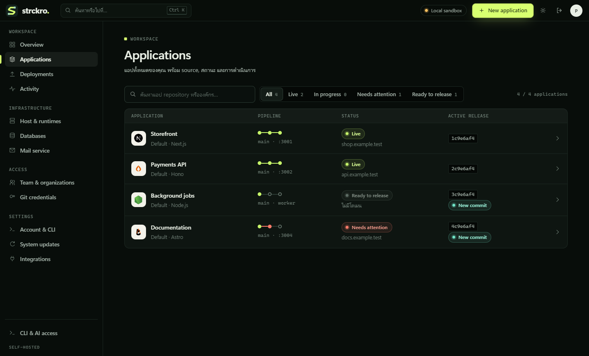

<div align="center">
  
  <h1>Strckro</h1>
  <p><strong>From Git to a running release on your own server.</strong></p>
  <p>A self-hosted deployment dashboard and CLI for one Linux host.</p>
  <p>
    <a href="README.th.md">ภาษาไทย</a> ·
    <a href="#install">Install</a> ·
    <a href="docs/en/README-index.md">Docs</a> ·
    <a href="https://github.com/raptercode/Strckro/releases/latest">Latest release</a> ·
    <a href="docs/en/donate.md">♥ Donate</a>
  </p>
</div>



## What you can do

- **Deploy from Git.** Build, run health checks, activate releases, and roll back from the same workspace. Use the dashboard or trigger deployments from CI.
- **Run apps and workers.** Choose Node.js, Bun, Go, Python, PHP, or Docker Compose for projects. Review build and runtime logs from the dashboard.
- **Keep files across releases.** Mount persistent storage for native projects and see usage, item count, and free disk space in the Storage tab. [Storage guide](docs/en/how-to/project-storage.md)
- **Operate the host.** Manage domains and HTTPS with Nginx and Let's Encrypt. Strckro stores repository credentials and environment values encrypted and controls project access by organization.

Strckro runs code from the repositories you connect. Use trusted repositories on the host. [Architecture and trust boundaries](docs/en/knowledge/context/architecture.md)

## Install

Use an interactive SSH session on an Ubuntu 24.04 or 25.04 amd64 server with sudo access. Point a domain at the server and allow inbound TCP ports 80 and 443.

```bash
curl -fsSL https://dashboard-portal.cloud/install.sh | bash
```

The installer prompts for your domain and a reachable TLS email. It installs the latest stable release and defaults to Node.js 24. The guide covers pinning a release, backups, and updates. [Production installation](docs/en/how-to/production-install.md)

## Try the dashboard locally

With Git and Node.js 24 installed, run the demo with sample projects and temporary data.

```bash
git clone https://github.com/raptercode/Strckro.git
cd Strckro
npm ci
npm run preview:ui
```

Open [127.0.0.1:4343](http://127.0.0.1:4343) and sign in with the demo credentials printed in the terminal.

## Deploy from your terminal

```bash
npm install -g strckro
skctl login --server https://portal.example.com
skctl deploy my-app --sync --wait --timeout 300
```

Use your Portal URL and project slug in the commands. The CLI also covers deployment history, domains, and environment values. [CLI guide](docs/en/how-to/cli.md)

## Support

If Strckro helps you run your projects, you can support its development or share feedback. [Donate](docs/en/donate.md) · [Report an issue](https://github.com/raptercode/Strckro/issues)

[Documentation](docs/en/README-index.md) · [Changelog](docs/en/CHANGELOG.md) · [MIT License](LICENSE) · [Runtime logo credits](public/ui/runtime-logos/SOURCES.md)
