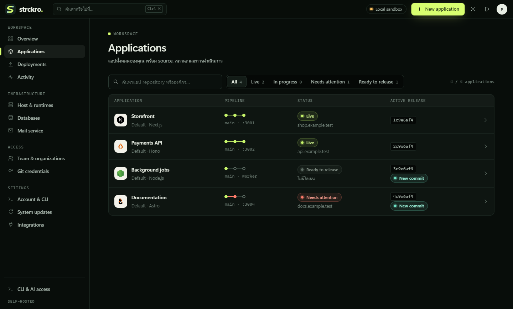

<div align="center">
  
  <h1>Strckro</h1>
  <p><strong>จาก Git สู่แอปที่รันบนเซิร์ฟเวอร์ของคุณ</strong></p>
  <p>แดชบอร์ดและ CLI สำหรับ deploy แอปบน Linux ที่คุณดูแลเอง</p>
  <p>
    <a href="README.md">English</a> ·
    <a href="docs/th/how-to/production-install.md">คู่มือติดตั้ง</a> ·
    <a href="docs/th/README-index.md">เอกสาร</a> ·
    <a href="https://github.com/raptercode/Strckro/releases/latest">รุ่นล่าสุด</a> ·
    <a href="docs/th/donate.md">♥ สนับสนุน</a>
  </p>
</div>



## ทำอะไรได้บ้าง

- **Deploy จาก Git** ตั้งค่า build ตรวจ health check เปิดใช้ release และ rollback ได้จากหน้าเดียว หรือสั่ง deploy ผ่าน CI
- **รันแอปและ worker** เลือก Node.js, Bun, Go, Python, PHP หรือ Docker Compose ให้โปรเจกต์ แล้วดู log ตอน build และตอนรันในแดชบอร์ด
- **เก็บไฟล์ข้าม release** ตั้งพื้นที่จัดเก็บถาวรให้โปรเจกต์แบบ native แล้วดูขนาด จำนวนรายการ และพื้นที่ดิสก์ที่เหลือในแท็บ Storage [คู่มือ Storage](docs/th/how-to/project-storage.md)
- **จัดการเซิร์ฟเวอร์** ตั้งค่าโดเมนและ HTTPS ด้วย Nginx กับ Let's Encrypt ระบบเก็บข้อมูลรับรอง Git และค่า environment แบบเข้ารหัส และกำหนดสิทธิ์เข้าถึงโปรเจกต์ตามองค์กรได้

Strckro รันโค้ดจาก repository ที่เชื่อมไว้ ให้เลือกเฉพาะ repository ที่คุณเชื่อถือ [สถาปัตยกรรมและขอบเขตความปลอดภัย](docs/th/knowledge/context/architecture.md)

## ติดตั้ง

เปิด SSH แบบ interactive บน Ubuntu 24.04 หรือ 25.04 amd64 ด้วยบัญชีที่ใช้ sudo ได้ ให้ DNS ของโดเมนชี้มาที่เซิร์ฟเวอร์และเปิด TCP ขาเข้า 80 กับ 443

```bash
curl -fsSL https://dashboard-portal.cloud/install.sh | bash
```

ตัวติดตั้งจะถามโดเมนและอีเมลที่ติดต่อได้สำหรับ TLS แล้วติดตั้งรุ่น stable ล่าสุด โดยใช้ Node.js 24 เป็นค่าเริ่มต้น วิธีเลือกรุ่น สำรองข้อมูล และอัปเดตอยู่ในคู่มือ [ติดตั้งบน Ubuntu](docs/th/how-to/production-install.md)

## ทดลองบนเครื่องตัวเอง

ติดตั้ง Git และ Node.js 24 แล้วรันเดโมที่ใช้ข้อมูลชั่วคราวและโปรเจกต์ตัวอย่าง

```bash
git clone https://github.com/raptercode/Strckro.git
cd Strckro
npm ci
npm run preview:ui
```

เปิด [127.0.0.1:4343](http://127.0.0.1:4343) แล้วใช้บัญชีเดโมที่แสดงใน terminal

## Deploy จาก terminal

```bash
npm install -g strckro
skctl login --server https://portal.example.com
skctl deploy my-app --sync --wait --timeout 300
```

เปลี่ยน URL และ slug ให้ตรงกับ Portal และโปรเจกต์ของคุณ CLI ใช้ดูประวัติ deploy จัดการโดเมน และแก้ค่า environment ได้ด้วย [คู่มือ CLI](docs/th/how-to/cli.md)

## สนับสนุน

ถ้า Strckro ช่วยให้คุณจัดการแอปได้ง่ายขึ้น คุณสามารถสนับสนุนการพัฒนาหรือส่งฟีดแบ็กได้ [ช่องทางสนับสนุน](docs/th/donate.md) · [แจ้งปัญหา](https://github.com/raptercode/Strckro/issues)

[สารบัญเอกสาร](docs/th/README-index.md) · [ประวัติการเปลี่ยนแปลง](docs/th/CHANGELOG.md) · [MIT License](LICENSE) · [เครดิตโลโก้ Runtime](public/ui/runtime-logos/SOURCES.md)
